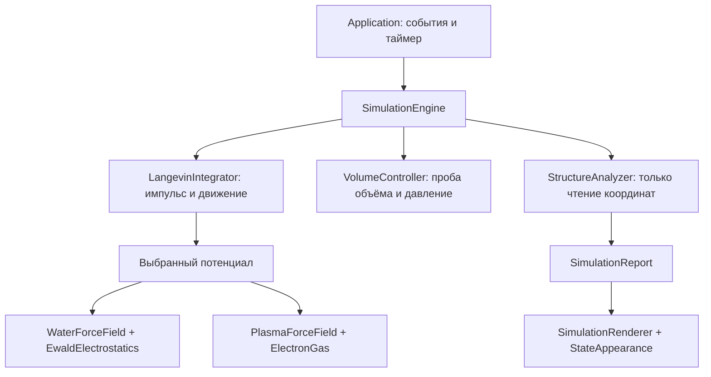

# Архитектура и назначение файлов

## Как проходит один шаг

При создании эксперимента `InitialConditions` размещает частицы, задаёт массы, заряды и начальные скорости. Движок один раз вычисляет силы. Интегратор использует их для первой половины изменения скоростей, передвигает частицы, обменивается энергией с баней, снова передвигает частицы, получает новые силы и завершает изменение скоростей.

После нескольких шагов движок измеряет температуру, давление и плотность. Анализатор независимо рассматривает расположение и перемещения атомов O. Его результат получает отрисовщик. Обратной связи от цвета к интегратору нет.

## Принципы ООП

- `SimulationEngine` владеет изменяемыми данными. Окно получает `const`-ссылки, поэтому отрисовка не может изменить частицы.
- Алгоритмы разделены по ответственности: потенциал, интегратор, баростат, измерение структуры, отрисовка, события окна.
- Движок собирается композицией. Два реализованных потенциала хранятся в `std::variant`; иерархии наследования нет.
- Простой общий контракт — `ForceEvaluation evaluate(ParticleSystem&)`. Потенциал записывает силы и возвращает согласованную с ними энергию.
- Структуры `Particle`, `Vec3`, `SimulationReport` являются данными. Правила владения, переключение модели и запуск расчёта находятся в классах.
- `BufferedPaint` владеет ресурсами GDI через RAII: создание и освобождение связаны временем жизни объекта.

## Каждый исходный файл

| Файл | Назначение |
| --- | --- |
| `src/main.cpp` | Создаёт оконное приложение, перехватывает ошибку старта и показывает сообщение Windows |
| `src/headless.cpp` | Запускает то же ядро без окна, проверяет аргументы и выводит итоговые измерения в CSV |
| `src/app/Application.h` | Объявляет владельца окна, движка, отрисовщика и состояния паузы |
| `src/app/Application.cpp` | Создаёт окно, принимает клавиши и таймер, запускает шаги, ставит расчёт на паузу при ошибке |
| `src/app/BufferedPaint.h` | Объявляет объект времени жизни сеанса рисования и двойного буфера |
| `src/app/BufferedPaint.cpp` | Вызывает BeginPaint/EndPaint, создаёт буфер, переносит кадр в окно и освобождает GDI-ресурсы |
| `src/app/SimulationRenderer.h` | Объявляет интерфейс отрисовки снимка расчёта |
| `src/app/SimulationRenderer.cpp` | Проецирует координаты в 2D, рисует куб, связи, частицы, измерения, легенду и управление; локальный SelectedFont освобождает шрифт |
| `src/app/StateAppearance.h` | Объявляет соответствие метки состояния цвету и подписи |
| `src/app/StateAppearance.cpp` | Хранит единственную палитру; H рисуется более светлым оттенком этого цвета |
| `src/physics/SimulationEngine.h` | Объявляет публичный интерфейс расчёта, отчёт и состав движка |
| `src/physics/SimulationEngine.cpp` | Создаёт эксперимент, выбирает потенциал, подбирает шаг, запускает интегратор и баростат, собирает измерения |
| `src/physics/core/ParticleSystem.h` | Определяет единицы, вектор, частицу, модели, периодическую ячейку, молекулярную топологию и результат потенциала |
| `src/physics/core/ParticleSystem.cpp` | Реализует периодические образы, энергии движения, температуру, удаление общего дрейфа и изменение объёма |
| `src/physics/core/LangevinIntegrator.h` | Объявляет интегратор BAOAB и функцию пересчёта сил |
| `src/physics/core/LangevinIntegrator.cpp` | Обновляет импульсы и координаты, выполняет точный шаг процесса Орнштейна — Уленбека для бани, учитывает переданное тепло |
| `src/physics/core/VolumeController.h` | Объявляет пробное изменение объёма и измерение давления |
| `src/physics/core/VolumeController.cpp` | Реализует баростат Метрополиса и оценку давления через малое виртуальное изменение объёма |
| `src/physics/models/InitialConditions.h` | Объявляет эксперименты, их исходные настройки и создание системы |
| `src/physics/models/InitialConditions.cpp` | Создаёт плотную конфигурацию, алмазную кислородную сетку Ic, пар, слой с газом или ионы; назначает скорости Максвелла |
| `src/physics/models/WaterForceField.h` | Объявляет гибкий молекулярный потенциал и его геометрические параметры |
| `src/physics/models/WaterForceField.cpp` | Считает энергию и силы связей O–H, угла H–O–H и взаимодействия O–O; вызывает Эвальд |
| `src/physics/models/EwaldElectrostatics.h` | Объявляет точность периодической электростатики |
| `src/physics/models/EwaldElectrostatics.cpp` | Считает реальную и обратную суммы, собственное поле и исключения внутри молекул |
| `src/physics/models/ElectronGas.h` | Объявляет термодинамические свойства электронного фона |
| `src/physics/models/ElectronGas.cpp` | Находит химический потенциал из числа электронов, вычисляет давление, свободную энергию и длину экранирования |
| `src/physics/models/PlasmaForceField.h` | Объявляет эффективный потенциал ионов и хранит объект электронного EOS |
| `src/physics/models/PlasmaForceField.cpp` | Считает силы Юкавы; кеширует электронную термодинамику при неизменных N/V/T |
| `src/physics/analysis/StructureAnalyzer.h` | Определяет наблюдаемые метки и результат анализа; хранит историю перемещений |
| `src/physics/analysis/StructureAnalyzer.cpp` | Считает соседей, тетраэдрический порядок, согласованность q6 и подвижность; формирует локальные цвета с задержкой смены меток |
| `tests/PhysicsTests.cpp` | Проверяет физические и численные свойства по независимым соотношениям, включая эталон Маделунга и идеальный газ |

## Файлы сборки и документации

| Файл | Назначение |
| --- | --- |
| `built.bat` | Подготовка MSVC, сборка Windows-приложения и запуск; UTF-8 для сообщений и исходников |
| `CMakeLists.txt` | Общая библиотека ядра, консольная программа, Windows-окно и CTest |
| `.github/workflows/build.yml` | Сборка и проверки Windows/Linux в GitHub Actions |
| `.gitignore` | Исключает результаты сборки и отладочные файлы |
| `README.md` | Запуск, клавиши, эксперименты, цвета и фактический охват режимов |
| `docs/ARCHITECTURE.md` | Этот документ: потоки данных и обязанности каждого файла |
| `docs/PHYSICS.md` | Уравнения, параметры, допущения, численная точность и научные источники |
| `docs/EXTENDING.md` | Порядок добавления нового потенциала и требования к проверке нового режима |

## Владение данными и ошибки

`ParticleSystem` не содержит оконных типов. Его координаты остаются непрерывными при переходе через границу; `PeriodicBox::wrap` используется при рисовании, `displacement` — при расчёте взаимодействий. Отдельный `transportA` накапливает движение от скорости без искусственного вклада изменения объёма.

Публичные методы движка проверяют конечность входных параметров. При численной ошибке шага восстанавливаются последние координаты и силы, а окно останавливает расчёт и предлагает `Home`. Общее состояние интегратора после ошибки не считается пригодным для продолжения: нужен сброс эксперимента.

Расчёт и отрисовка сейчас выполняются в потоке окна. Число шагов за кадр меняет скорость продвижения физического времени. Для больших систем потребуется отдельный вычислительный поток и передача неизменяемого снимка вместо общей изменяемой системы.
